<a id="pt"></a>
<p align="center">
  <a href="https://auralisgame.vercel.app/">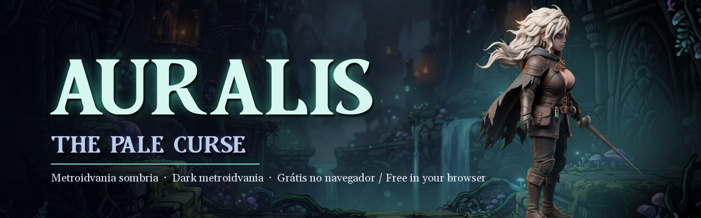</a>
</p>

<p align="center"><b>Português (BR)</b> · <a href="#english">English ↓</a></p>

<h3 align="center">Uma metroidvania sombria sobre a menina que o mundo chamou de praga.</h3>

<p align="center">
  <a href="https://auralisgame.vercel.app/"></a>
  <a href="releases/AURALIS-Setup.exe"></a>
  <a href="https://auralisgame.vercel.app/auralis_trailer.mp4"></a>
</p>
<p align="center">
  
  
  
  
  
</p>

<p align="center">
  <a href="https://auralisgame.vercel.app/auralis_trailer.mp4">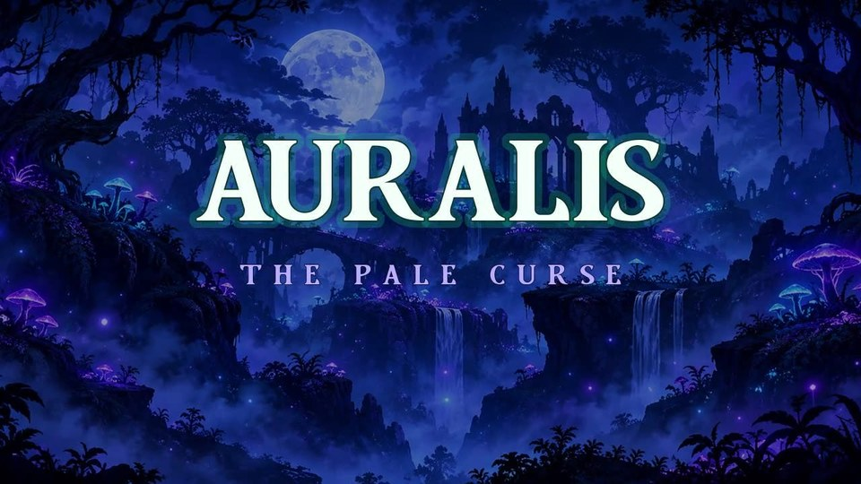</a><br>
  <sub>▶ Clique para ver o trailer (49 segundos, gravado dentro do próprio jogo) · <a href="https://auralisgame.vercel.app/sobre">página do jogo</a></sub>
</p>

---

## Jogue em 10 segundos

Não precisa instalar nem criar conta: **abra [auralisgame.vercel.app](https://auralisgame.vercel.app/) no computador e aperte jogar.** O jogo é grátis.
Prefere uma versão instalada? Há um instalador para **Windows 64 bits** (veja [Como instalar](#como-instalar)).

<p align="center">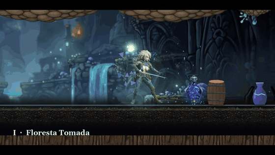<br><sub>Combate com peso: golpes, magia e frascos</sub></p>
<p align="center">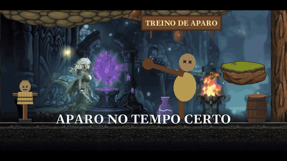<br><sub>Aparo no tempo certo: o boneco de treino ensina o ritmo</sub></p>
<p align="center">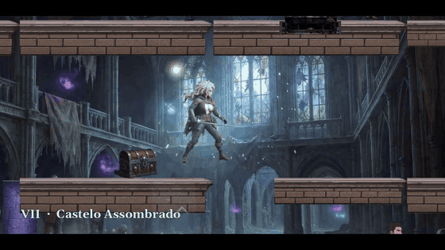<br><sub>Exploração: pulos, plataformas e inimigos</sub></p>

## A história

Num mundo que adora a noite, nasceu uma menina de pele e cabelos claros como marfim. Os anciãos a chamaram de **praga**, e a Casa da Noite,
que venera a pele imaculada como religião, abandonou-a na floresta para morrer.

A floresta a criou. Deu a ela cicatrizes, garras e uma raiva muito bem treinada. Dezoito invernos depois, **Auralis** deixa o único lar que conheceu
e sobe, fase a fase, em direção a uma torre no topo do mundo, onde mora o Sumo Mago que decide o que é "puro". No caminho existem criaturas, ruínas,
escolhas difíceis e um irmão, **Vaelin**, que ficou do outro lado dessa história.

O tom é sombrio, mas humano: o jogo quer que você entenda quem está do outro lado da espada, e às vezes poupar alguém muda como tudo termina.

## Por que jogar

- **Dez fases, dez lugares diferentes.** Da Floresta Tomada ao Observatório Celeste, passando por pântano, caverna de cristais, esgotos, vulcão, masmorra, castelo e uma cidade mecânica.
- **Combate com peso.** Golpes encadeados, ataque carregado, magia, esquiva, subarmas e um **aparo** que recompensa o tempo certo: defenda no instante exato para ganhar MP e deixar o próximo golpe mais forte. Há um boneco de treino logo no começo.
- **Você cresce de verdade.** Árvore de habilidades em três ramos (Lâmina, Arcano e Sombra), oito habilidades de movimento e combate que abrem caminhos novos, amuletos e mercador.
- **Mapa para explorar.** Mapa com névoa, minimapa, atalhos que se abrem, altares de viagem rápida, poços de queda e áreas que só o dash ou o pulo duplo alcançam.
- **Chefes com nome e história.** Nove chefes opcionais escondidos atrás de selos quase invisíveis, cada um com falas antes e depois da luta. Os chefes lutam em duas fases.
- **Dois finais.** O que você escolhe, e quem você poupa, muda o desfecho.
- **Com voz.** Falas e cenas dubladas em português e inglês, com legendas em oito idiomas.
- **Jogue acompanhado.** Coop local para dois jogadores: o segundo controla o Vaelin.
- **Para quem gosta de desafio e de coleção.** Arena de chefes, desafio diário, 61 conquistas, galeria de arte e modo assistência para quem só quer curtir a história.

## Galeria

<table>
<tr>
<td width="50%">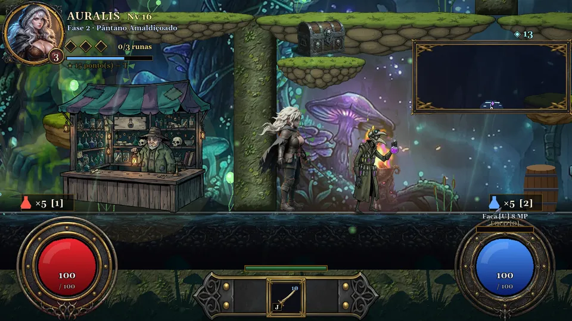<br><sub><b>2</b> · Pântano Amaldiçoado</sub></td>
<td width="50%">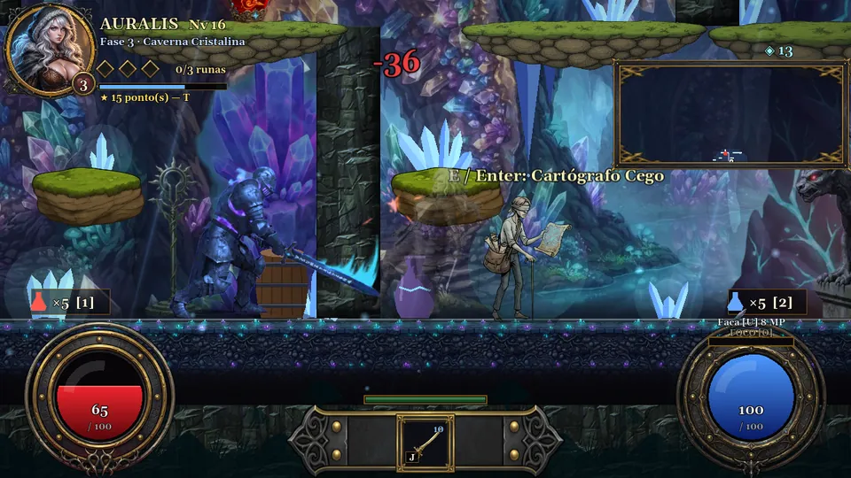<br><sub><b>3</b> · Caverna Cristalina</sub></td>
</tr>
<tr>
<td>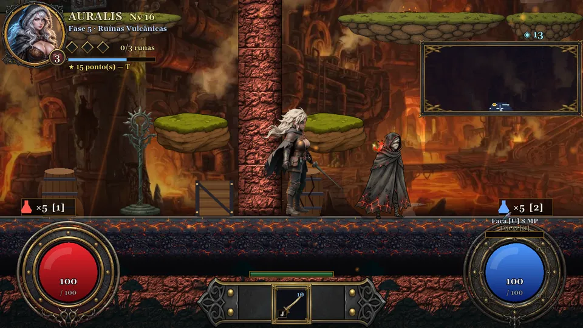<br><sub><b>5</b> · Ruínas Vulcânicas</sub></td>
<td>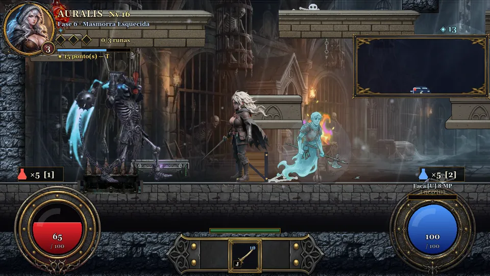<br><sub><b>6</b> · Masmorra Esquecida</sub></td>
</tr>
<tr>
<td>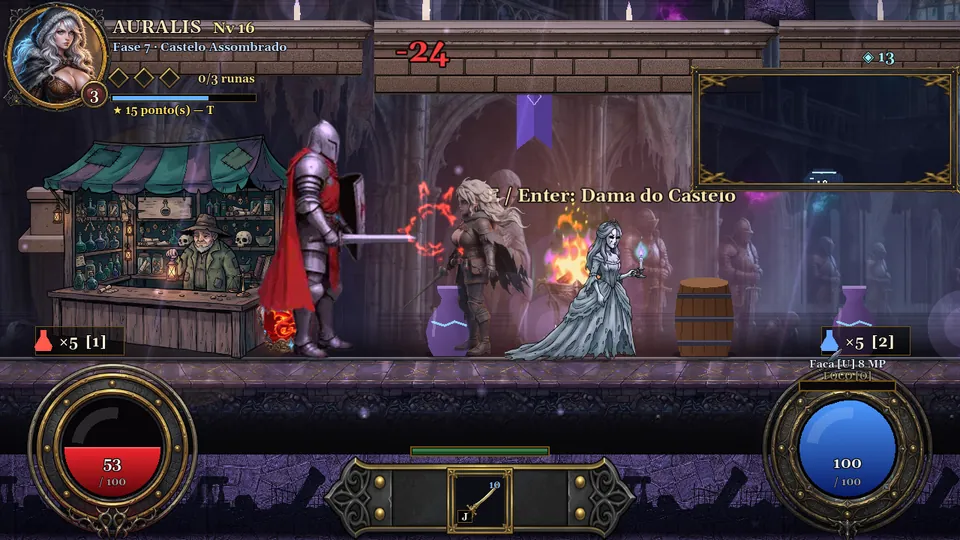<br><sub><b>7</b> · Castelo Assombrado</sub></td>
<td>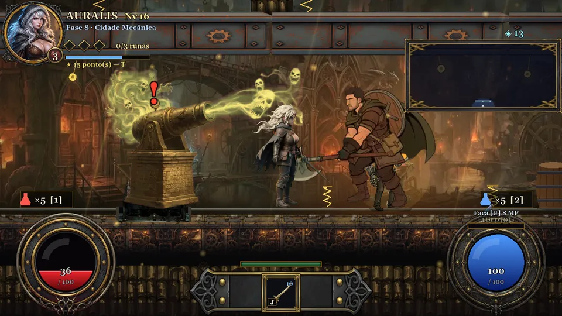<br><sub><b>8</b> · Cidade Mecânica</sub></td>
</tr>
<tr>
<td>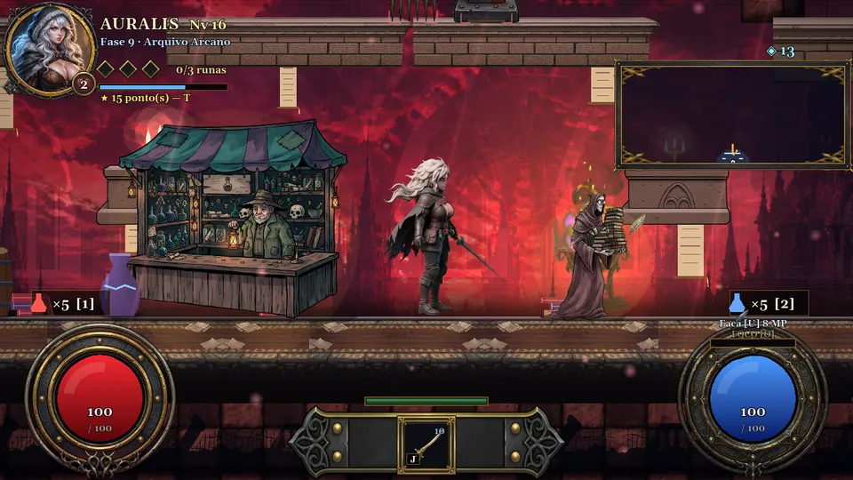<br><sub><b>9</b> · Arquivo Arcano</sub></td>
<td>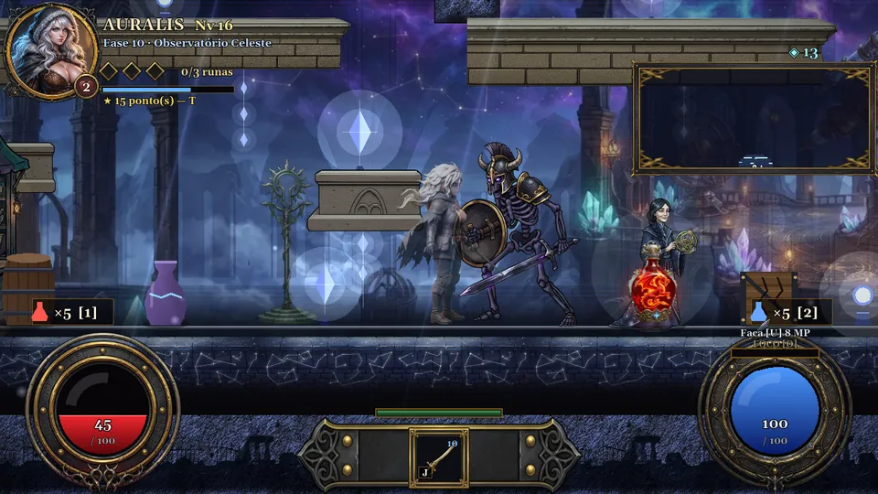<br><sub><b>10</b> · Observatório Celeste</sub></td>
</tr>
</table>

## Fases e chefes

| Fase | Lugar | Chefe opcional nomeado |
|:-:|---|---|
| 1 | Floresta Tomada | (a fase de apresentação) |
| 2 | Pântano Amaldiçoado | Velho Carvalho Rancoroso |
| 3 | Caverna Cristalina | Sir Valdric, o Penitente |
| 4 | Esgotos Sombrios | Mãe do Lodo |
| 5 | Ruínas Vulcânicas | Ignarr, a Forja Viva |
| 6 | Masmorra Esquecida | Alcaide Sem Chaves |
| 7 | Castelo Assombrado | O Elmo Sem Dono |
| 8 | Cidade Mecânica | Engrenagem-Mestra |
| 9 | Arquivo Arcano | ??? (um nome que você já conhece) |
| 10 | Observatório Celeste | ??? (a Maldição o reconhece) |

Além dos nomeados, há chefes principais pelo caminho, e um chefe final escondido na Arena. Os nomes das fases 9 e 10 ficam em segredo de propósito.

## Modos de jogo

| Modo | O que é |
|---|---|
| **História** | A campanha completa: as dez fases, os dois finais, com dificuldade ajustável e modo assistência. |
| **Coop local (2 jogadores)** | Dois jogadores, uma tela. O jogador 2 é o Vaelin. Aparecem mais inimigos e os chefes ficam mais fortes. |
| **Arena de chefes** | Os nove chefes nomeados em sequência, com 3 vidas e placar de tempo. Libera depois de derrotar o primeiro nomeado. Existe um chefe escondido no fim. |
| **Desafio diário** | Uma fase e três modificadores novos por dia (iguais para todo mundo). Limpe 5 ondas no menor tempo e mantenha a sequência. |
| **Desafio de ondas** | Seis ondas de inimigos no ponto em que você está, a partir do menu de pausa. |
| **Treino de aparo** | Boneco de treino no começo da fase 1 para aprender o tempo da defesa. |

## Controles

Todas as teclas podem ser redefinidas em **Opções → Controles**.

| Ação | Teclado | Controle |
|---|---|---|
| Mover | A / D ou setas | Analógico esquerdo ou direcional |
| Pular | Espaço, W ou ↑ | A |
| Atacar | J (ou X, Z) | X |
| Ataque carregado (segurar e soltar) | K (ou C) | Y |
| Magia | L (ou V) | B |
| Esquiva (dash) | Shift (ou Q) | RB |
| Defesa / aparo | F (ou B) | LB |
| Mergulho no ar | S ou ↓ | Direcional ↓ |
| Fúria | R (ou E) | R3 |
| Mini mapa | M | L3 |
| Árvore de habilidades | T | (pelo menu) |
| Pausar / menu | P / Esc | Start / Back |

**Coop local:** o jogador 1 usa o teclado (A/D, Espaço, J K L, Shift) ou o controle 1. O jogador 2 usa as setas e o teclado numérico
(← → mover · ↑ pular · ↓ mergulho · Num1 ataque · Num2 carga · Num3 raio · Num0 dash · Num4 escudo · Num Enter reviver) ou o controle 2.
No celular há botões de toque na tela, que você pode reposicionar nas Opções.

## Idiomas

| | Idioma | Voz | Legenda |
|:-:|---|:-:|:-:|
| 🇧🇷 | Português (Brasil) | sim | sim |
| 🇺🇸 | English | sim | sim |
| 🇫🇷 | Français | não | sim |
| 🇪🇸 | Español | não | sim |
| 🇩🇪 | Deutsch | não | sim |
| 🇮🇹 | Italiano | não | sim |
| 🇰🇷 | 한국어 | não | sim |
| 🇯🇵 | 日本語 | não | sim |

Menus e interface estão em português e inglês. A voz e a legenda são escolhidas separadamente (você pode ouvir em inglês e ler em japonês, por exemplo) na primeira vez que abre o jogo, e dá para mudar depois em Opções.
As traduções de francês, espanhol, alemão, italiano, coreano e japonês ainda estão em refinamento: se achar algo estranho, [avise](https://github.com/bruno-a-dias/auralis-divulgacao/issues/new/choose).

<a id="como-instalar"></a>
## Como instalar

<table>
<tr>
<td width="33%" valign="top">

### 1 · Navegador
**O mais rápido.**
Abra **[auralisgame.vercel.app](https://auralisgame.vercel.app/)** e jogue. Sem instalar nada. Navegador moderno (Chrome, Edge, Firefox) no computador.
Dica: o botão *Instalar como aplicativo* no topo da página deixa o jogo com ícone próprio e funcionando offline depois do primeiro carregamento.

</td>
<td width="33%" valign="top">

### 2 · Windows
**Instalador pequeno.**
Baixe **[AURALIS-Setup.exe](releases/AURALIS-Setup.exe)** (menos de 1 MB), execute e siga as telas. Ele baixa o jogo (cerca de 180 MB) daqui mesmo, confere cada parte e instala só para o seu usuário, sem pedir administrador.

</td>
<td width="33%" valign="top">

### 3 · Manual
**Sem o instalador.**
Baixe as partes em [dados/](dados/), junte e extraia você mesmo. O passo a passo está em
[Instalação manual](#instalação-manual--offline-alternativa).

</td>
</tr>
</table>

> **A tela azul "O Windows protegeu seu computador"**
> É normal por enquanto. O Windows mostra esse aviso para qualquer programa novo de um autor independente que ainda não tem "reputação" e que ainda não foi assinado digitalmente
> (a assinatura exige um certificado pago, e o AURALIS ainda não tem). Não significa que o arquivo tenha vírus, mas você não precisa confiar às cegas:
> o código do instalador e o SHA-256 oficial estão neste repositório, e você pode conferir o hash antes de abrir (veja abaixo).
> Para continuar: clique em **Mais informações** e depois em **Executar assim mesmo**.

<details>
<summary><b>Instruções completas de instalação, requisitos, verificação e problemas comuns</b></summary>

## Requisitos

- Windows 10 ou 11, **64 bits**
- Placa de vídeo com suporte a OpenGL 3.3 (renderizador de compatibilidade do Godot)
- Cerca de **170 MB de download** e **250 MB livres** em disco
- Internet apenas para instalar (o jogo roda offline)
- Não precisa de administrador: instala só para o seu usuário

## Como instalar (passo a passo)

1. Baixe o instalador: **[releases/AURALIS-Setup.exe](releases/AURALIS-Setup.exe)** (botão *Download raw file* na página do arquivo).
2. (Recomendado) Confira o SHA-256, veja [Verificação do instalador](#verificação-do-instalador).
3. Execute o `AURALIS-Setup.exe`. Se aparecer a tela azul do SmartScreen, veja [Aviso azul do Windows](#aviso-azul-do-windows-smartscreen).
4. Escolha o idioma (Português ou English) e clique em **Avançar**.
5. Na tela de **autorização**, leia de onde os arquivos serão baixados e o tamanho, marque **"Autorizo o download dos arquivos do jogo"** e avance. Sem a autorização a instalação não continua.
6. Escolha a pasta (padrão: `%LOCALAPPDATA%\Programs\AURALIS`) e os atalhos (Menu Iniciar e/ou Área de Trabalho).
7. Aguarde: o instalador baixa as partes, confere o SHA-256 de cada uma e do pacote completo, junta, descompacta e instala.
   Se a internet cair, ele tenta de novo 3 vezes por parte; ao executar de novo, as partes já baixadas e verificadas são reaproveitadas.
8. Marque **Executar AURALIS** e clique em **Concluir**.

Instalação silenciosa (para automação): `AURALIS-Setup.exe /S /ACCEPT` (opcionais: `/D=C:\Pasta`, `/LANG=en`).
`/ACCEPT` significa que você autoriza o download.

#### Aviso azul do Windows (SmartScreen)

Enquanto o instalador não for **assinado digitalmente**, o Windows mostra "O Windows protegeu seu computador".
Isso acontece com qualquer programa de um autor independente que ainda não tem reputação, não significa que há vírus.
Assinar exige um certificado de assinatura de código (pago, com verificação de identidade); o instalador ainda não é assinado.
Para continuar: clique em **Mais informações** e depois em **Executar assim mesmo**.
Se preferir, confira o SHA-256 do instalador (abaixo) antes de executar.

#### Verificação do instalador

O SHA-256 oficial fica em [releases/SHA256.txt](releases/SHA256.txt). No PowerShell, na pasta do download:

```powershell
Get-FileHash .\AURALIS-Setup.exe -Algorithm SHA256
```

(ou no Prompt de Comando: `certutil -hashfile AURALIS-Setup.exe SHA256`). O resultado deve ser idêntico ao do arquivo.

#### Instalação manual / offline (alternativa)

Sem o instalador, você pode montar o jogo à mão:

1. Baixe de [dados/](dados/) todos os arquivos `AURALIS-<versão>.partNNN.<hash>` e o `manifesto.json`.
2. No Prompt de Comando, na pasta dos arquivos, junte as partes em ordem: `copy /b AURALIS-*.part* AURALIS.zip`
3. Confira: `certutil -hashfile AURALIS.zip SHA256` deve ser igual ao campo `sha256_zip` do `manifesto.json`.
4. Extraia o zip (botão direito → Extrair tudo) numa pasta sua e execute `AURALIS.exe`.

Para instalar a partir de um espelho/rede local use `AURALIS-Setup.exe /BASEURL=http://servidor/pasta/` (a pasta deve ter `latest.json` e `dados/`).

### Desinstalar

Configurações → Aplicativos → Aplicativos instalados → **AURALIS: The Pale Curse** → Desinstalar
(ou o atalho *Desinstalar AURALIS* no Menu Iniciar). Seus saves em `%APPDATA%\Godot\app_userdata\AURALIS- The Pale Curse` são mantidos; apague essa pasta se quiser removê-los.

### Problemas comuns

| Sintoma | O que fazer |
|---|---|
| Aviso azul do SmartScreen | Mais informações → Executar assim mesmo (veja acima) |
| "Não foi possível consultar o servidor" | Verifique internet, proxy e firewall; clique em *Tentar novamente* |
| Falha de rede no meio do download | Execute o instalador de novo; partes já verificadas não são baixadas outra vez |
| "A verificação SHA-256 falhou" | Execute de novo; se persistir, baixe o instalador de novo e confira o hash. Nada é instalado com dados inválidos |
| "Arquivo em uso" | Feche o AURALIS e tente novamente |
| Espaço insuficiente | O instalador usa a pasta temporária (cerca de 2x o download) e a pasta do jogo; libere espaço |
| Antivírus bloqueia o PowerShell | O download usa o PowerShell do Windows; permita a execução ou use a instalação manual |
| Tela preta/erro gráfico ao abrir o jogo | Atualize o driver da placa de vídeo |

</details>

## Perguntas frequentes

<details>
<summary><b>É grátis?</b></summary>
Sim. Jogar no navegador e baixar o instalador não custam nada.
</details>

<details>
<summary><b>Preciso de internet?</b></summary>
No navegador, precisa carregar o jogo na primeira vez; depois de instalado como aplicativo (PWA) ele pode rodar sem conexão. No Windows, a internet só é necessária para instalar: o jogo em si roda offline.
</details>

<details>
<summary><b>O jogo salva o progresso?</b></summary>
Sim, com tela de saves e a opção Continuar com um resumo do seu jogo. No navegador, o save fica guardado no próprio navegador deste aparelho: limpar os dados do site apaga o progresso, e ele não vai com você para outro computador. No Windows fica na pasta de dados do usuário (veja Desinstalar).
</details>

<details>
<summary><b>Dá para jogar com controle?</b></summary>
Sim, há suporte a controle (os botões podem ser redefinidos e os rótulos mudam entre Xbox e PlayStation). Se o seu modelo não for reconhecido, [conte pra gente](https://github.com/bruno-a-dias/auralis-divulgacao/issues/new/choose).
</details>

<details>
<summary><b>E no celular?</b></summary>
Há botões de toque na tela (reposicionáveis) e um modo desempenho nas Opções, mas o jogo foi pensado para computador e a experiência no celular ainda está em teste. Se tentar, jogue na horizontal.
</details>

<details>
<summary><b>Tem multijogador?</b></summary>
Tem coop **local** para dois jogadores na mesma tela. Não existe jogo online.
</details>

<details>
<summary><b>Tem versão para Mac, Linux ou consoles?</b></summary>
Ainda não há versão nativa. No Mac e no Linux, use a versão para navegador.
</details>

<details>
<summary><b>É muito difícil?</b></summary>
Tem peso, mas dá para ajustar: há escolha de dificuldade e um modo assistência (menos dano recebido, aparo mais folgado), além de filtros de cor, redução de tremor e de clarões.
</details>

<details>
<summary><b>Achei um bug. E agora?</b></summary>
[Abra um relato](https://github.com/bruno-a-dias/auralis-divulgacao/issues/new/choose) dizendo a versão, o navegador ou o Windows e o que você estava fazendo. Isso ajuda muito.
</details>

## Novidades

**0.99.046 · Coop local, idiomas e modos extras**
- Coop local para 2 jogadores, com o Vaelin como segundo jogador.
- Legendas em francês, espanhol, alemão, italiano, coreano e japonês, e tela de idioma na primeira vez que o jogo abre.
- Vozes dos chefes em português e inglês.
- Arena de chefes, chefe final escondido e Desafio diário no menu Modos extras.
- Boneco de treino para aprender o aparo, tela Continuar com resumo e galeria de arte no menu de pausa.

**0.99.045 · Poços, segredos e elevadores longos**
- Poços de queda, áreas que só o dash ou o pulo duplo alcançam e segredos novos pelas fases, marcados no mapa.
- Aparo no tempo certo; chefes em duas fases; dois finais diferentes.
- Provas e puzzles em salas secretas e mapa de passagens secretas à venda no mercador.

**0.99.044 · Retratos dos chefes e pisos novos**
- Chefes nomeados com retrato ilustrado próprio nas conversas; pisos novos nas fases 3, 5 e 7.

Histórico completo dentro do jogo, em Opções → Atualizações. Notas desta versão: [RELEASE_NOTES_0.99.046.md](RELEASE_NOTES_0.99.046.md).

## Roadmap

- **1.0:** em preparação. Até lá a versão continua subindo a cada atualização (0.99.x).
- Refinar o **coop local** e as **traduções** (francês, espanhol, alemão, italiano, coreano e japonês).
- Mais polimento de equilíbrio, desempenho e correções de bugs.
- Assinatura digital do instalador do Windows (para sumir o aviso azul), quando for possível.

O que vem depois depende de você: o feedback orienta as prioridades.

## Feedback e apoio

- Bug ou ideia: **[abra um relato aqui](https://github.com/bruno-a-dias/auralis-divulgacao/issues/new/choose)** (há modelos prontos em português).
- Jogou e gostou? Conte para um amigo, deixe uma estrela neste repositório e compartilhe o link do jogo: **https://auralisgame.vercel.app/**
- Autor: [github.com/bruno-a-dias](https://github.com/bruno-a-dias) · [uiclap.bio/badmask_84](https://uiclap.bio/badmask_84)

## Créditos

Jogo, história, design, texto e direção: **Bruno Assunção Dias**.
Arte e animações criadas com ferramentas de IA generativa e tratadas pelo autor; código assistido por IA (Claude, da Anthropic), com refinamentos e ajustes manuais; as vozes das falas são sintetizadas por voz artificial (TTS).
Engine: [Godot](https://godotengine.org/) 4.3 (licença MIT). Efeitos visuais: BinbunVFX (CC0). Pacotes de personagens (Goblin Scout e Knight Sprite Pack) e Textures Pack 1, conforme os termos de cada pacote.
Fonte Gelasio (licença OFL); símbolos em DejaVu Sans (licença livre Bitstream Vera). Efeitos sonoros sintetizados no projeto; trilhas conforme os créditos dentro do jogo.
Agradecimentos a Pedro, Karine, Arthur Falcomer, Disparter, aos alunos e colegas do autor, à família e a todos que testaram.

## Licença e uso

© 2026 Bruno Assunção Dias. **Todos os direitos reservados.** AURALIS: The Pale Curse, seu código, arte, textos, vozes e músicas
pertencem ao autor. Fica permitido **jogar e distribuir o instalador (`AURALIS-Setup.exe`) sem modificações**, gratuitamente.
Não é permitido modificar, revender, redistribuir separadamente os dados do jogo, nem usar o material em outros projetos sem autorização por escrito.
O Godot Engine é distribuído sob licença MIT.

<p align="right"><a href="#pt">↑ topo</a> · <a href="#english">English ↓</a></p>

---

<a id="english"></a>
<p align="center">
  <a href="https://auralisgame.vercel.app/"></a>
</p>

<p align="center"><a href="#pt">↑ Português (BR)</a> · <b>English</b></p>

<h3 align="center">A dark metroidvania about the girl the world called a plague.</h3>

<p align="center">
  <a href="https://auralisgame.vercel.app/"></a>
  <a href="releases/AURALIS-Setup.exe"></a>
  <a href="https://auralisgame.vercel.app/auralis_trailer.mp4"></a>
</p>
<p align="center">
  
  
  
  
  
</p>

<p align="center">
  <a href="https://auralisgame.vercel.app/auralis_trailer.mp4"></a><br>
  <sub>▶ Click to watch the trailer (49 seconds, recorded inside the game itself) · <a href="https://auralisgame.vercel.app/sobre">game page</a></sub>
</p>

---

## Play in 10 seconds

No install, no account: **open [auralisgame.vercel.app](https://auralisgame.vercel.app/) on a computer and hit play.** The game is free.
Prefer an installed version? There is an installer for **64-bit Windows** (see [How to install](#how-to-install)).

<p align="center"><br><sub>Weighty combat: strikes, spell and flasks</sub></p>
<p align="center"><br><sub>Perfect parry: the training dummy teaches the timing</sub></p>
<p align="center"><br><sub>Exploration: jumps, platforms and foes</sub></p>

## The story

In a world that worships the night, a girl was born with skin and hair pale as ivory. The elders called her a **plague**, and the House of Night,
which venerates unblemished skin as a religion, left her in the forest to die.

The forest raised her. It gave her scars, claws and a very well-trained anger. Eighteen winters later, **Auralis** leaves the only home she has known
and climbs, level by level, toward a tower at the top of the world, where the High Mage who decides what is "pure" lives. Along the way:
creatures, ruins, hard choices, and a brother, **Vaelin**, who stayed on the other side of this story.

The tone is dark but human: the game wants you to understand who stands on the other end of the sword, and sometimes sparing someone changes how everything ends.

## Why play

- **Ten levels, ten different places.** From the Overgrown Forest to the Celestial Observatory, through a swamp, a crystal cavern, sewers, a volcano, a dungeon, a castle and a clockwork city.
- **Combat with weight.** Chained strikes, charged attack, spell, dodge, sub-weapons and a **parry** that rewards timing: guard at the exact instant to gain MP and make your next hit stronger. A training dummy waits at the start.
- **You really grow.** A skill tree with three branches (Blade, Arcane and Shadow), eight movement and combat abilities that open new paths, charms and a merchant.
- **A map worth exploring.** Fogged map, minimap, shortcuts that open up, fast-travel altars, fall shafts and areas only the dash or the double jump can reach.
- **Named bosses with a story.** Nine optional bosses hidden behind nearly invisible seals, each with lines before and after the fight. Bosses fight in two phases.
- **Two endings.** What you choose, and whom you spare, changes the outcome.
- **Voiced.** Dialogue and cutscenes voiced in Portuguese and English, with subtitles in eight languages.
- **Play together.** Local 2-player co-op: the second player controls Vaelin.
- **For challenge and collection fans.** Boss Arena, Daily Challenge, 61 achievements, an art gallery, and an assist mode for those who just want the story.

## Gallery

<table>
<tr>
<td width="50%"><br><sub><b>2</b> · Cursed Swamp</sub></td>
<td width="50%"><br><sub><b>3</b> · Crystal Cavern</sub></td>
</tr>
<tr>
<td><br><sub><b>5</b> · Volcanic Ruins</sub></td>
<td><br><sub><b>6</b> · Forgotten Dungeon</sub></td>
</tr>
<tr>
<td><br><sub><b>7</b> · Haunted Castle</sub></td>
<td><br><sub><b>8</b> · Mechanical City</sub></td>
</tr>
<tr>
<td><br><sub><b>9</b> · Arcane Archive</sub></td>
<td><br><sub><b>10</b> · Celestial Observatory</sub></td>
</tr>
</table>

## Levels and bosses

| Level | Place | Named optional boss |
|:-:|---|---|
| 1 | Overgrown Forest | (the introduction level) |
| 2 | Cursed Swamp | Grudge-Bearing Old Oak |
| 3 | Crystal Cavern | Sir Valdric the Penitent |
| 4 | Gloomy Sewers | Mother of the Mire |
| 5 | Volcanic Ruins | Ignarr, the Living Forge |
| 6 | Forgotten Dungeon | The Keyless Warden |
| 7 | Haunted Castle | The Masterless Helm |
| 8 | Mechanical City | The Master Gear |
| 9 | Arcane Archive | ??? (a name you already know) |
| 10 | Celestial Observatory | ??? (the Curse knows him) |

Besides the named ones there are main bosses along the way, and a hidden final boss in the Arena. The names for levels 9 and 10 are kept secret on purpose.

## Game modes

| Mode | What it is |
|---|---|
| **Story** | The full campaign: ten levels, two endings, adjustable difficulty and assist mode. |
| **Local co-op (2 players)** | Two players, one screen. Player 2 is Vaelin. More enemies show up and bosses are tougher. |
| **Boss Arena** | The nine named bosses in a row, with 3 lives and a time scoreboard. Unlocks after you beat the first named boss. A hidden boss waits at the end. |
| **Daily Challenge** | A level and three new modifiers every day (the same for everyone). Clear 5 waves in the shortest time and keep your streak. |
| **Wave challenge** | Six waves of foes right where you stand, from the pause menu. |
| **Parry training** | A training dummy at the start of level 1 to learn the guard timing. |

## Controls

Every key can be remapped in **Options → Controls**.

| Action | Keyboard | Gamepad |
|---|---|---|
| Move | A / D or arrows | Left stick or D-pad |
| Jump | Space, W or ↑ | A |
| Attack | J (or X, Z) | X |
| Charged attack (hold and release) | K (or C) | Y |
| Spell | L (or V) | B |
| Dodge (dash) | Shift (or Q) | RB |
| Guard / parry | F (or B) | LB |
| Air dive | S or ↓ | D-pad ↓ |
| Fury | R (or E) | R3 |
| Minimap | M | L3 |
| Skill tree | T | (via the menu) |
| Pause / menu | P / Esc | Start / Back |

**Local co-op:** player 1 uses the keyboard (A/D, Space, J K L, Shift) or gamepad 1. Player 2 uses the arrow keys and numpad
(← → move · ↑ jump · ↓ dive · Num1 attack · Num2 charge · Num3 bolt · Num0 dash · Num4 shield · Num Enter revive) or gamepad 2.
On phones there are on-screen touch buttons you can reposition in Options.

## Languages

| | Language | Voice | Subtitles |
|:-:|---|:-:|:-:|
| 🇧🇷 | Português (Brasil) | yes | yes |
| 🇺🇸 | English | yes | yes |
| 🇫🇷 | Français | no | yes |
| 🇪🇸 | Español | no | yes |
| 🇩🇪 | Deutsch | no | yes |
| 🇮🇹 | Italiano | no | yes |
| 🇰🇷 | 한국어 | no | yes |
| 🇯🇵 | 日本語 | no | yes |

Menus and interface are in Portuguese and English. Voice and subtitles are chosen separately (you can listen in English and read in Japanese, for instance) the first time you open the game, and changed later in Options.
The French, Spanish, German, Italian, Korean and Japanese translations are still being refined: if something looks off, [let us know](https://github.com/bruno-a-dias/auralis-divulgacao/issues/new/choose).

<a id="how-to-install"></a>
## How to install

<table>
<tr>
<td width="33%" valign="top">

### 1 · Browser
**The fastest.**
Open **[auralisgame.vercel.app](https://auralisgame.vercel.app/)** and play. Nothing to install. A modern browser (Chrome, Edge, Firefox) on a computer.
Tip: the *Install as app* button at the top of the page gives the game its own icon and lets it run offline after the first load.

</td>
<td width="33%" valign="top">

### 2 · Windows
**Tiny installer.**
Download **[AURALIS-Setup.exe](releases/AURALIS-Setup.exe)** (under 1 MB), run it and follow the screens. It downloads the game (about 180 MB) from this very repository, verifies every part and installs for your user only, with no admin rights.

</td>
<td width="33%" valign="top">

### 3 · Manual
**Without the installer.**
Download the parts from [dados/](dados/), join and extract them yourself. Steps in
[Manual install](#manual--offline-install-alternative).

</td>
</tr>
</table>

> **The blue "Windows protected your PC" screen**
> It is expected for now. Windows shows it for any new program from an independent author that has no "reputation" yet and is not digitally signed
> (signing needs a paid certificate, which AURALIS does not have yet). It does not mean the file has a virus, but you do not have to trust blindly:
> the installer's official SHA-256 is in this repository and you can check the hash before opening it (see below).
> To continue: click **More info**, then **Run anyway**.

<details>
<summary><b>Full install instructions, requirements, verification and troubleshooting</b></summary>

## Requirements

- Windows 10 or 11, **64-bit**
- A GPU with OpenGL 3.3 support (Godot compatibility renderer)
- About **170 MB download** and **250 MB free** disk space
- Internet only for installing (the game runs offline)
- No administrator rights needed: installs for your user only

## How to install (step by step)

1. Download the installer: **[releases/AURALIS-Setup.exe](releases/AURALIS-Setup.exe)** (*Download raw file* on the file page).
2. (Recommended) Check its SHA-256, see [Verifying the installer](#verifying-the-installer).
3. Run `AURALIS-Setup.exe`. If the blue SmartScreen screen appears, see [Blue Windows warning](#blue-windows-warning-smartscreen).
4. Pick the language (Português or English) and click **Next**.
5. On the **authorization** page, read where the files are downloaded from and how big they are, tick **"I authorize downloading the game files"** and continue. Without it, the installation does not proceed.
6. Choose the folder (default `%LOCALAPPDATA%\Programs\AURALIS`) and shortcuts (Start Menu and/or Desktop).
7. Wait: the installer downloads the parts, verifies the SHA-256 of each part and of the whole package, joins, unpacks and installs.
   If the connection drops it retries 3 times per part; when you run it again, parts already downloaded and verified are reused.
8. Tick **Run AURALIS** and click **Finish**.

Silent install (automation): `AURALIS-Setup.exe /S /ACCEPT` (optional: `/D=C:\Folder`, `/LANG=en`). `/ACCEPT` means you authorize the download.

#### Blue Windows warning (SmartScreen)

Until the installer is **digitally signed**, Windows shows "Windows protected your PC". This happens to any program from an
independent author that has no reputation yet; it does not mean there is malware. Signing requires a paid code-signing certificate
with identity verification; the installer is not signed yet. To proceed click **More info**, then **Run anyway**.

#### Verifying the installer

The official SHA-256 is in [releases/SHA256.txt](releases/SHA256.txt). In PowerShell, in the download folder:

```powershell
Get-FileHash .\AURALIS-Setup.exe -Algorithm SHA256
```

(or in Command Prompt: `certutil -hashfile AURALIS-Setup.exe SHA256`). The result must match the file.

#### Manual / offline install (alternative)

1. Download from [dados/](dados/) every `AURALIS-<version>.partNNN.<hash>` file and `manifesto.json`.
2. In Command Prompt, in that folder, join the parts in order: `copy /b AURALIS-*.part* AURALIS.zip`
3. Check: `certutil -hashfile AURALIS.zip SHA256` must equal `sha256_zip` in `manifesto.json`.
4. Extract the zip (right-click → Extract all) to a folder of your own and run `AURALIS.exe`.

To install from a mirror/local network use `AURALIS-Setup.exe /BASEURL=http://server/folder/` (the folder must contain `latest.json` and `dados/`).

### Uninstall

Settings → Apps → Installed apps → **AURALIS: The Pale Curse** → Uninstall (or the *Uninstall AURALIS* Start Menu shortcut).
Your saves in `%APPDATA%\Godot\app_userdata\AURALIS- The Pale Curse` are kept; delete that folder to remove them.

### Troubleshooting

| Symptom | What to do |
|---|---|
| Blue SmartScreen warning | More info → Run anyway (see above) |
| "Could not reach the server" | Check internet, proxy and firewall; click *Try again* |
| Network failure mid-download | Run the installer again; verified parts are not downloaded twice |
| "SHA-256 verification failed" | Run again; if it persists, re-download the installer and check its hash. Nothing is installed with invalid data |
| "File in use" | Close AURALIS and try again |
| Not enough space | The installer uses the temp folder (about 2x the download) and the game folder; free some space |
| Antivirus blocks PowerShell | The download uses Windows PowerShell; allow it or use the manual install |
| Black screen / graphics error | Update your graphics driver |

</details>

## FAQ

<details>
<summary><b>Is it free?</b></summary>
Yes. Playing in the browser and downloading the installer cost nothing.
</details>

<details>
<summary><b>Do I need internet?</b></summary>
In the browser you need to load the game the first time; once installed as an app (PWA) it can run offline. On Windows, internet is only needed to install: the game itself runs offline.
</details>

<details>
<summary><b>Does it save my progress?</b></summary>
Yes, with a saves screen and a Continue option showing a summary of your game. In the browser, the save lives in that browser on that device: clearing the site's data erases it, and it does not follow you to another computer. On Windows it is kept in the user data folder (see Uninstall).
</details>

<details>
<summary><b>Can I play with a gamepad?</b></summary>
Yes, gamepads are supported (buttons can be remapped and labels switch between Xbox and PlayStation). If yours is not recognized, [tell us](https://github.com/bruno-a-dias/auralis-divulgacao/issues/new/choose).
</details>

<details>
<summary><b>What about phones?</b></summary>
There are on-screen touch buttons (repositionable) and a performance mode in Options, but the game was designed for computers and the phone experience is still being tested. If you try, play in landscape.
</details>

<details>
<summary><b>Is there multiplayer?</b></summary>
There is **local** co-op for two players on the same screen. There is no online play.
</details>

<details>
<summary><b>Is there a Mac, Linux or console version?</b></summary>
Not yet. On Mac and Linux, use the browser version.
</details>

<details>
<summary><b>Is it very hard?</b></summary>
It has weight, but you can tune it: there is a difficulty choice and an assist mode (less damage taken, a more forgiving parry), plus color filters and reduced screen shake and flashes.
</details>

<details>
<summary><b>I found a bug. Now what?</b></summary>
[Open a report](https://github.com/bruno-a-dias/auralis-divulgacao/issues/new/choose) with the version, your browser or Windows, and what you were doing. It helps a lot.
</details>

## What's new

**0.99.046 · Local co-op, languages and extra modes**
- Local 2-player co-op, with Vaelin as the second player.
- Subtitles in French, Spanish, German, Italian, Korean and Japanese, and a language screen the first time the game opens.
- Boss voices in Portuguese and English.
- Boss Arena, a hidden final boss and the Daily Challenge in the Extra modes menu.
- Training dummy to learn the parry, a Continue screen with a summary and an art gallery in the pause menu.

**0.99.045 · Shafts, secrets and long lifts**
- Fall shafts, areas only the dash or double jump can reach, and new secrets across the levels, marked on the map.
- Perfect parry; two-phase bosses; two different endings.
- Trials and puzzles in secret rooms and a secret-passages map for sale at the merchant.

**0.99.044 · Boss portraits and new floors**
- Named bosses with their own illustrated portraits in conversations; new floors in levels 3, 5 and 7.

Full history inside the game, in Options → Updates. Notes for this version: [RELEASE_NOTES_0.99.046.md](RELEASE_NOTES_0.99.046.md).

## Roadmap

- **1.0:** in preparation. Until then the version keeps climbing with each update (0.99.x).
- Refine **local co-op** and the **translations** (French, Spanish, German, Italian, Korean and Japanese).
- More balance polish, performance work and bug fixes.
- Digital signature for the Windows installer (to get rid of the blue warning), when possible.

What comes next depends on you: feedback sets the priorities.

## Feedback and support

- Bug or idea: **[open a report here](https://github.com/bruno-a-dias/auralis-divulgacao/issues/new/choose)** (templates are in Portuguese; English is welcome).
- Played and liked it? Tell a friend, star this repository and share the game link: **https://auralisgame.vercel.app/**
- Author: [github.com/bruno-a-dias](https://github.com/bruno-a-dias) · [uiclap.bio/badmask_84](https://uiclap.bio/badmask_84)

## Credits

Game, story, design, writing and direction: **Bruno Assunção Dias**.
Art and animation made with generative AI tools and refined by the author; code assisted by AI (Claude, by Anthropic), with manual refinements; dialogue voices are synthesized (TTS).
Engine: [Godot](https://godotengine.org/) 4.3 (MIT). Visual effects: BinbunVFX (CC0). Character packs (Goblin Scout and Knight Sprite Pack) and Textures Pack 1 under each pack's own terms.
Font Gelasio (OFL); symbols in DejaVu Sans (free Bitstream Vera license). Sound effects synthesized in the project; music tracks as credited in the game.
Thanks to Pedro, Karine, Arthur Falcomer, Disparter, the author's students and colleagues, family, and everyone who tested.

## License and use

© 2026 Bruno Assunção Dias. **All rights reserved.** AURALIS: The Pale Curse, its code, art, text, voices and music belong to the author.
You may **play and distribute the unmodified installer (`AURALIS-Setup.exe`)** free of charge. Modifying, reselling, redistributing the game data separately,
or reusing the material in other projects requires written permission. Godot Engine is distributed under the MIT license.

<p align="right"><a href="#english">↑ top</a> · <a href="#pt">Português ↑</a></p>
